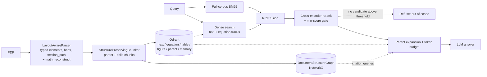

# Research_RAG — Multi-track scientific RAG for boundary-layer transition literature

A retrieval stack for scientific PDFs (equations, tables, figures, section structure), built and benchmarked on a corpus of **39 papers on bypass / free-stream-turbulence-induced boundary-layer transition**.

What makes it different from a plain chunk-and-embed RAG:

- **Typed, layout-aware parsing.** PDFs become typed elements (heading / paragraph / equation / table / figure / caption) with bounding boxes, reading order and a heading path, instead of a flat text stream.
- **Structure-preserving chunking.** Section-level *parent* chunks plus *child* chunks. Tables stay atomic, and equations are bundled with their defining paragraph.
- **Multi-track vector store.** One Qdrant instance with separate collections per content type and payload pre-filtering.
- **Deterministic structure graph.** Section containment, equation/figure/table cross-references and paper-to-paper citations, built without any LLM at index time.
- **Hybrid retrieval.** Full-corpus BM25 plus dense search, fused with RRF, reranked by a cross-encoder with a score threshold that doubles as an out-of-domain refusal gate, then expanded from child hits to their parent sections (small-to-big).

> **Status in one line:** the parse → chunk → index → retrieve → rerank → expand path is implemented and benchmarked. Several designed components (MMR, query router, CRAG gate, episodic memory, the 6-stage Docling router) are implemented and unit-tested but **not yet part of the benchmarked path**. Neo4j and bibliography parsing are **not implemented**. See [Status](#status).

---

## Architecture



Solid arrows are the benchmarked path. Dotted arrows are data lookups.

---

## Status

| Component | Module(s) | State |
|---|---|---|
| Element schema | `bl_pipeline/rag/schema.py` | Used, tested |
| Layout-aware parser | `rag/parsers/layout_parser.py`, `math_reconstruct.py`, `glyph_map.json` | Implemented, tested. The indexing driver that calls it is not committed (see [Known limitations](#known-limitations)) |
| 6-stage Docling router (triage, table dissector, formula reconciler, figure analyzer, quality gates) | `rag/parsers/{triage,router,cell_dissector,formula_reconciler,figure_analyzer,quality_gates,docling_parser}.py` | Implemented, **no tests**, not on the benchmarked path. Needs `docling` |
| Structure-preserving chunker | `rag/structured_chunker.py` | Used, tested |
| Hierarchical (4-tier) tree chunker | `rag/hierarchical_chunker.py` | Implemented, tested, not on the benchmarked path |
| Exact + near-duplicate dedup | `rag/dedup.py` | Implemented, tested, not on the benchmarked path |
| Multi-track Qdrant store | `rag/qdrant_store.py` | Used, tested |
| Scientific tokenizer + RRF | `rag/hybrid_search.py` | `rrf_fusion` used. Candidate-level `SimpleBM25` / `apply_hybrid_search` tested but not used |
| Full-corpus BM25 | `ScientificCorpusBM25` in `rag/eval_benchmark.py` | Used |
| Cross-encoder reranker | `rag/reranker.py` | Used, tested |
| Parent expansion + token budgeter | `rag/parent_child.py`, `rag/token_budgeter.py` | Used |
| Structure graph | `rag/graph/structure_graph.py` | Used for citation queries. `contains` / `refers_to` edges implemented and tested |
| Query router | `rag/router.py` | Implemented, tested. Instantiated by the benchmark but not used |
| CRAG quality gate | `rag/crag_gate.py` | Implemented, tested. The benchmark uses a plain cross-encoder score cutoff instead |
| MMR diversity selection | `rag/mmr.py` | Implemented, tested, not on the benchmarked path |
| Episodic memory | `rag/episodic_memory.py` | Implemented, tested, not on the benchmarked path |
| Figure / table tracks | Qdrant collections exist | The benchmark queries only `text` and `equation` |
| **Bibliography → citation edges** | — | **Not implemented.** Citation edges in the benchmark are added by hand |
| **Neo4j graph store** | — | **Not implemented.** The graph is NetworkX with JSON save/load |

---

## Components

### Parsing: `LayoutAwareParser`
`parse_pdf(path, paper_id)` returns a list of `DocumentElement` objects in reading order, each with `element_type`, `section_path`, `page`, `bbox` and `text`.

Equation regions are handled by `math_reconstruct.py`: it finds a tight formula rectangle, classifies the equation as simple or complex, and rebuilds simple ones from character spans, decoding glyphs through `glyph_map.json` rather than the PDF's `/ToUnicode` table. Optional OCR (`enable_equation_ocr`: EasyOCR / PaddleOCR) and vision math (`enable_vision_math`: pix2tex) are **off by default**.

`math_reconstruct` is imported as a top-level module, so run from the repository root.

### Chunking: `StructurePreservingChunker`
`chunk_elements(elements, paper_id)` returns `StructuredChunk`s:

- one **parent** chunk per section (`element_type="parent"`)
- **child** chunks (`paragraph`, `equation`, `table`, `figure`) that carry `parent_id`
- tables are never split mid-row, and an oversized table splits on row boundaries with the header repeated
- equations are bundled with their defining paragraph
- page numbers, running headers, acknowledgements, references and similar noise are dropped

### Store: `QdrantMultiTrackStore`
Six collections: `text`, `equation`, `table`, `figure`, `parent`, `memory`. `location` can be `":memory:"`, a directory path (on-disk), or an `http(s)://` URL. `search` and `search_multitrack` accept a `payload_filter` dict, for example `{"paper_id": "mayle_1991"}`, applied as a Qdrant pre-filter. `vector_size` must match your embedder (384 for `all-MiniLM-L6-v2`).

### Retrieval
1. **BM25** over every text/equation chunk (an in-memory index with a scientific tokenizer that keeps symbols and constants such as `Re_theta`, `Tu`, `163`, `6.91`, and maps Greek letters to names). A paper-name boost applies when query tokens match a `paper_id`.
2. **Dense** search over the `text` and `equation` tracks.
3. **RRF** fusion (`k=60`).
4. Top 15 candidates are enriched with their parent section and scored by the **cross-encoder** (`cross-encoder/ms-marco-MiniLM-L-6-v2`). Candidates below `--min-score` (default `-1.5`) are dropped. If nothing survives, the system refuses.
5. **Parent expansion**: `expand_and_deduplicate` collapses child hits that share a parent (max 3 parents), and `format_llm_context_block` assembles a token-budgeted context envelope (default budget 4,500 tokens).

Citation queries ("who cites X") skip retrieval and are answered from graph edges (`get_citing_papers` / `get_cited_papers`).

### Structure graph: `DocumentStructureGraph`
NetworkX `DiGraph`. Nodes are papers, sections and chunks. Edges:

| Edge | Source | Status |
|---|---|---|
| `contains` | heading hierarchy / parent-child chunks | implemented |
| `refers_to` | regex over "Eq. (3.6)", "Fig. 4.2", "Table 2" | implemented |
| `cites` | paper → paper | `add_citation()` exists, but **nothing populates it from bibliographies** |

Useful queries: `get_chunks_referencing_equation(paper_id, eq_id)`, `get_section_chunks(paper_id, section_path)`, `get_sibling_nodes(...)`, `get_citing_papers(paper_id)`. `save_to_file` / `load_from_file` round-trip to JSON.

---

## Install

```bash
python -m venv .venv && source .venv/bin/activate     # Windows: .venv\Scripts\activate
pip install pymupdf pillow qdrant-client networkx numpy openai \
            sentence-transformers torch pytest
```

Optional:

| Package | Needed for |
|---|---|
| `docling` | the 6-stage `ScientificDocumentRouter` |
| `easyocr` or `paddleocr` | `enable_equation_ocr` |
| `pix2tex` | `enable_vision_math` |
| `langfuse` | tracing spans in episodic memory |

Create a `.env` in the repo root (only needed for the benchmark's LLM steps):

```
GROQ_API_KEY=...
GROQ_MODEL=qwen/qwen3.8-27b      # optional; this is the default
HF_TOKEN=...                      # optional; avoids Hugging Face rate limits
```

---

## Quickstart: index a paper and query it

Run from the repository root.

```python
import numpy as np
from sentence_transformers import SentenceTransformer

from bl_pipeline.rag.parsers.layout_parser import LayoutAwareParser
from bl_pipeline.rag.structured_chunker import StructurePreservingChunker
from bl_pipeline.rag.graph.structure_graph import DocumentStructureGraph
from bl_pipeline.rag.qdrant_store import QdrantMultiTrackStore
from bl_pipeline.rag.parent_child import ParentChildRetriever
from bl_pipeline.rag.router import QueryRouter

embedder = SentenceTransformer("all-MiniLM-L6-v2")          # 384-d
embed = lambda texts: embedder.encode(texts, convert_to_numpy=True).tolist()

# 1. Parse -> typed elements, then chunk -> parent + child chunks
paper_id = "mayle_1991"
elements = LayoutAwareParser().parse_pdf("data/papers/mayle_1991.pdf", paper_id=paper_id)
chunks = StructurePreservingChunker().chunk_elements(elements, paper_id=paper_id)

# 2. Index: route each chunk to its track
store = QdrantMultiTrackStore(location="runs/qdrant_index", vector_size=384)
by_track = {}
for c in chunks:
    track = "parent" if c.element_type == "parent" else \
            "text" if c.element_type == "paragraph" else c.element_type
    by_track.setdefault(track, []).append(c)
for track, cs in by_track.items():
    store.upsert_chunks(track, cs, embed([c.content for c in cs]))

# 3. Structure graph
graph = DocumentStructureGraph()
graph.add_paper(paper_id)
for c in chunks:
    graph.add_chunk(c)
graph.save_to_file("runs/structure_graph.json")

# 4. Query: dense search over text + equation tracks, optionally pre-filtered
query = "onset correlation Re_theta_t as a function of Tu"
print(QueryRouter().route_query(query).primary_tracks)       # e.g. ['equation', 'text']
hits = store.search_multitrack(["text", "equation"], embed([query])[0],
                               limit_per_track=15,
                               payload_filter={"paper_id": paper_id})

# 5. Small-to-big: collapse to parent sections
retriever = ParentChildRetriever(store.client, parent_collection="parent")
contexts = retriever.expand_and_deduplicate(hits, max_parents=3)
prompt_context = retriever.format_llm_context_block(contexts, query=query)
```

For the full hybrid path (BM25 + RRF + cross-encoder + score gate), see `run_scaled_50q_benchmark` in `bl_pipeline/rag/eval_benchmark.py`.

---

## Benchmark

50 queries over the 39-paper corpus: **42 in-domain** across 9 categories plus **8 out-of-domain** probes (4 of the 50 are citation queries). The queries and the grading rubric live in `bl_pipeline/rag/eval_benchmark.py` (`SCALED_50_EVAL_SET`, `grade_chunk_relevance`).

**Prerequisite:** a prebuilt Qdrant index at `runs/qdrant_scaled_corpus_v2` (about 12k points across tracks) with 384-d `all-MiniLM-L6-v2` vectors. It is not in the repo (`runs/` is gitignored).

```bash
# Run as a module (see Known limitations for why)
python -m bl_pipeline.rag.eval_benchmark --limit 5            # quick check
python -m bl_pipeline.rag.eval_benchmark                      # full run
python -m bl_pipeline.rag.eval_benchmark --min-score -1.5 --groq-delay 2.0
```

Results are printed and saved to `runs/rag_benchmark_scaled_50q_metrics.json`.

| Metric | Definition |
|---|---|
| Hit@1/3/5 | first chunk with grade ≥ 2 within the top k |
| MRR | reciprocal rank of the first grade ≥ 2 chunk |
| Graded nDCG@5 | gains `2^g − 1` against an ideal list `[3, 2, 2, 1, 1]` |
| Context precision | share of returned chunks with grade ≥ 2 |
| Noise rate | share of returned chunks with grade 0 |
| OOD rejection | share of the 8 OOD probes that return zero chunks |
| Faithfulness / context relevance | LLM-judge scores (0–100) from the Groq model |

Relevance grades (0–3) come from `grade_chunk_relevance`: paper-name match plus keyword hits against the chunk text.

---

## Tests

```bash
python -m pytest bl_pipeline -q
```

The suite (55 tests) runs on CPU with no API keys. Files covering this stack:

```
bl_pipeline/agent1_fresh/tests/test_schema_and_parser.py
bl_pipeline/agent1_fresh/tests/test_chunker_and_dedup.py
bl_pipeline/agent1_fresh/tests/test_qdrant_store.py
bl_pipeline/agent1_fresh/tests/test_structure_graph.py
bl_pipeline/agent1_fresh/tests/test_hybrid_and_reranker.py
bl_pipeline/agent1_fresh/tests/test_retrieval_pipeline_v2.py
bl_pipeline/agent1_fresh/tests/test_episodic_memory.py
```

Other tests in that folder cover the inherited agent (see below), so a full run also needs its dependencies (`anthropic`, `chromadb`, `rank_bm25`, `scipy`, `sympy`, `pyyaml`, `python-dotenv`, `matplotlib`).

---

## Repository layout (this stack)

```
bl_pipeline/rag/
├── schema.py                 element / table / figure schema
├── parsers/                  layout_parser (used) + 6-stage Docling router pieces
├── structured_chunker.py     parent/child chunking
├── hierarchical_chunker.py   4-tier tree chunker
├── dedup.py                  exact + near-dup
├── qdrant_store.py           multi-track store
├── hybrid_search.py          scientific tokenizer, BM25, RRF
├── reranker.py               cross-encoder reranker
├── parent_child.py           small-to-big expansion
├── token_budgeter.py         context budgeting + envelope
├── router.py                 query router
├── crag_gate.py              retrieval quality gate
├── mmr.py                    diversity selection
├── episodic_memory.py        diagnostic memory (memory track)
├── graph/structure_graph.py  deterministic structure graph
└── eval_benchmark.py         50-query benchmark
math_reconstruct.py           rule-based equation reconstruction
glyph_map.json                per-font glyph overrides
docs/RAG_ARCHITECTURE.md      design notes (design intent; the Status table above is authoritative)
```

**Inherited code (not covered by this README).** `bl_pipeline/agent1_fresh/`, `rag/engine.py`, `rag/ingestion.py`, `rag/weighted_retriever.py` and related modules are the earlier Chroma-based agent this work was built on. It uses a different embedder and reranker and is **not connected** to the stack above.

---

## Known limitations

**Reproducibility**
- The script that builds the Qdrant index from PDFs is not committed, and `QdrantMultiTrackStore.upsert_chunks` has no caller outside tests. The benchmark therefore needs an externally built index. The Quickstart shows the indexing flow component by component.
- The benchmark prints two different index sizes (12,104 and 12,614 points). Confirm against the actual index.
- Run the benchmark with `python -m ...`. Running `python bl_pipeline/rag/eval_benchmark.py` directly fails because `bl_pipeline/rag/collections.py` shadows the standard-library `collections` module.

**Reading the benchmark numbers**
- All 42 in-domain queries name the target paper's author or year, and BM25 adds a boost when query tokens match a `paper_id`. Results largely reflect "find the paper named in the query"; they are not yet a measure of open-ended discovery.
- Grading is keyword and paper-name based, and any chunk containing generic domain terms ("transition", "boundary layer") earns grade 1. nDCG, context precision and noise rate are therefore optimistic. Hit@k (grade ≥ 2) is stricter.
- Citation queries are answered from five hand-added graph edges, and a returned chunk counts as relevant if its text contains "cites".
- LLM-judge scores include fixed defaults: OOD refusals are scored 100/100, and a failed or unparsable judge call falls back to 85/80 or 90/75. The same model generates and judges answers.

**Retrieval scope**
- Only the `text` and `equation` tracks are queried. Table, figure and memory tracks are not part of the benchmarked path.
- MMR, the query router, the CRAG gate and episodic memory are not applied in the benchmark.
